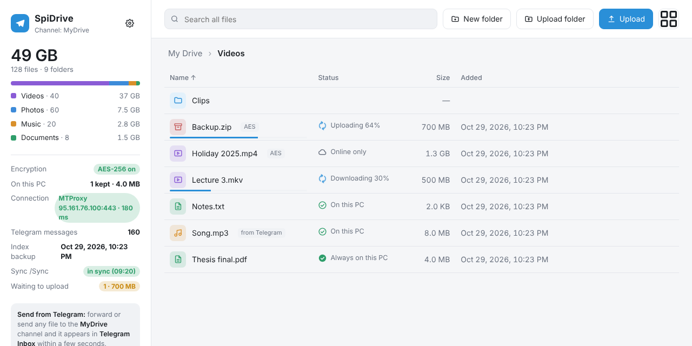

# SpiDrive

**Turn your Telegram account into a personal cloud drive on Windows.**

SpiDrive stores your files in a private Telegram channel that only you can see, and shows them as a normal
drive in File Explorer, in a web dashboard, and in folders that stay in sync with your PC. Telegram has no
fixed storage limit, so neither does SpiDrive. Everything runs on your own computer: no server, no account
with us, and your encryption key never leaves your device.



## Features

- **A drive in File Explorer.** Drag and drop files and folders, open, rename and delete them like on any disk.
- **Web dashboard.** Browse, search and upload. Photos, music and videos stream straight from Telegram, with
  seeking, without downloading the whole file first.
- **Two-way sync.** A folder on your PC stays identical to a folder on the drive, including renames.
  Deleted files go to a trash on both sides.
- **From Telegram to your drive.** Anything you send or forward to your storage channel from your phone
  appears in the drive within seconds.
- **Large files.** Files bigger than Telegram's 2 GB limit are split into parts and joined again automatically.
- **AES-256 encryption (optional).** Files are encrypted on your PC before they are uploaded. Even file
  names are hidden in the channel.
- **File status like OneDrive.** See which files are online only, on this PC, or always kept on this PC,
  with live upload and download progress. *Keep on this PC* and *Free up space* with one click.
- **Works where Telegram is blocked.** Connects through your VPN app or a proxy link, or finds a working
  MTProto proxy automatically, and switches when one stops working.
- **Share files** with any Telegram contact in one click.
- **Safe by design.** Uploads resume after a disconnect, every part is checked with SHA-256, and the file
  index is backed up to your channel every day.

## Installation

### Option 1: Installer (recommended)

1. Download **`SpiDrive-Setup.exe`** from the [Releases](../../releases) page and run it.
2. A setup page opens in your browser. Log in with your phone number and the code Telegram sends you.
3. Choose a storage channel, encryption and a drive letter. Done.

Windows may show *"Windows protected your PC"* the first time. Click **More info → Run anyway**.

### Option 2: Run from source

Requirements: Windows 10 or 11 and [Python 3.10+](https://www.python.org/downloads/windows/)
(tick *"Add python.exe to PATH"* during installation).

```bat
git clone https://github.com/<your-username>/SpiDrive.git
cd SpiDrive
SpiDrive.bat
```

`SpiDrive.bat` installs everything that is missing (Python packages, [WinFsp](https://winfsp.dev) and
[rclone](https://rclone.org) for the drive letter), then starts SpiDrive. The first run takes a few
minutes; later runs start in seconds. The setup page opens in your browser the first time.

You need your own Telegram API ID: create an app at [my.telegram.org/apps](https://my.telegram.org/apps) and
enter the **api_id** and **api_hash** on the setup page.

### Build the installer yourself

Put your `config.py` (see `config.example.py`) in the folder and run `build.bat`. It creates
`dist\SpiDrive-Setup.exe` with [PyInstaller](https://pyinstaller.org) and [Inno Setup](https://jrsoftware.org/isinfo.php).

## Usage

- **Open SpiDrive:** click its icon next to the Windows clock. Right-click it for *Open drive*, *Restart* and *Quit*.
- **Dashboard:** http://127.0.0.1:8000
- **Settings:** the gear button in the dashboard: drive letter and size, encryption, sync folders,
  connection and proxy, start with Windows.
- **Stop SpiDrive:** right-click the tray icon → **Quit SpiDrive**.

The full user guide (sync, proxy, file status, recovery, troubleshooting) is in [GUIDE.md](GUIDE.md).

## How it works

```
 File Explorer (S:)   Web dashboard   Synced folders
          \                |                /
           SpiDrive engine (runs on your PC)
     split · encrypt · SHA-256 · SQLite index · upload queue
                           |
                  MTProto (direct or proxy)
                           |
            Your private Telegram channel
```

Each file is stored as one or more messages in your private channel. A local SQLite index records which
messages belong to which file. Encryption uses AES-256-CTR with a key derived from your passphrase
(scrypt), which also allows streaming and seeking in encrypted files.

## Project structure

| File | Purpose |
|---|---|
| `app.py` | The app: tray icon, setup wizard, restarts, start with Windows |
| `drive_core.py` | Storage engine: parts, encryption, index, uploads, downloads |
| `server.py` | Web dashboard and its API |
| `dav.py`, `mount.py` | The drive letter (WebDAV server + rclone/WinFsp) |
| `sync.py` | Two-way folder sync |
| `proxy.py` | Direct, manual-proxy or automatic-proxy connection to Telegram |
| `settings.py`, `setup_server.py` | Settings and the first-run setup page |
| `drive.py` | Command-line tool |
| `web/` | Dashboard and setup pages |
| `SpiDrive.bat` | Install what is missing and start (run from source) |
| `build.bat`, `SpiDrive.iss` | Build the `.exe` and the installer |

## Security and privacy

- Your Telegram login (`*.session`), `config.py`, `app_id.py` and `settings.json` give access to your
  account and files. **Never share or upload them.** They are listed in `.gitignore`.
- If you lose your encryption passphrase, encrypted files cannot be recovered.
- A proxy cannot read your files (Telegram traffic is encrypted), but it can see when and how much data
  you send.
- Telegram stores your data. Keep another copy of anything irreplaceable.

## Team

| Name | Role |
|---|---|
| ______________________ | ______________________ |
| ______________________ | ______________________ |
| ______________________ | ______________________ |
| ______________________ | ______________________ |

## License

______________________ <!-- for example MIT or GPL-3.0: add the matching LICENSE file -->

## Disclaimer

SpiDrive uses the Telegram API. It is not made by, endorsed by or affiliated with Telegram. Use it in line
with [Telegram's Terms of Service](https://telegram.org/tos) and
[API Terms](https://core.telegram.org/api/terms).

Third-party software used by SpiDrive is listed in `THIRD_PARTY.txt`.
